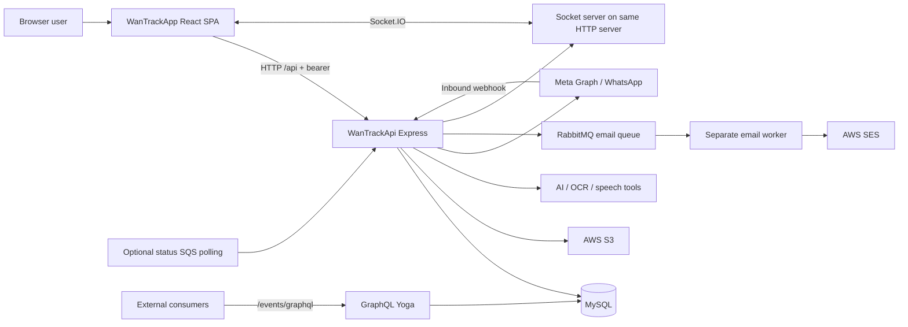

# System design and repository relationship

## Product boundary

WanTrackApp is a React browser application for company/user administration, WhatsApp accounts and templates, campaigns, chatbot conversation definitions, live support, leads, call analysis, reporting, email templates and document verification. Labels are predominantly Spanish. It is based on the Black Dashboard React template, with both product screens and remaining demo screens/assets.

WanTrackApi supplies HTTP endpoints, Socket.IO notifications, SQL persistence, WhatsApp/Meta communication, bot execution, AI/OCR/audio processing, file storage, email delivery and external integrations. Its events/guests GraphQL module is present in backend source but has no identified frontend consumer here. An API feature need not have a WanTrackApp screen: external clients, webhooks and jobs also consume it.

```text
WanTrack/
├── WanTrackApp/                 frontend Git repository; this SDD lives here
│   ├── src/
│   ├── Documentation/sdd/
│   └── backend/WanTrackApi      tracked gitlink, empty in this checkout
└── WanTrackApi/                 actual sibling backend Git repository
    ├── src/
    ├── migrations/
    └── package.json
```

The gitlink does not mean this browser app runs a backend internally. No `.gitmodules` file was found in the tracked frontend baseline. Resolve and check the sibling repository before editing API code. If a different checkout is used, explicitly update the documentation generator's path argument. Frontend and backend have independent commits, dependencies and deployment lifecycles.

## Runtime architecture



This depicts code connections, not a deployment inventory. MongoDB support exists, but its initialization is commented out in `src/api.ts`. RabbitMQ connection is initiated during normal API startup; the email worker is a separate executable module. WhatsApp SQS polling is enabled only when `ENABLE_WHATSAPP_STATUS_SQS` equals `true`.

## Frontend boot and boundaries

`src/index.js` mounts React with theme and background contexts, then BrowserRouter. `/admin/*` renders `layouts/Admin/Admin.js`; `/login/*` renders the login layout; other paths redirect to `/admin`. The admin layout validates a saved token, refreshes the user's module metadata, and mounts the routes from `src/routes.js`. The sidebar filters menu presentation; mounted routes are not individually protected by the same module filter.

Most screens directly own data fetching, transformation, form state and rendering. There is no centralized domain API client, Redux store, generated OpenAPI client or shared frontend/backend DTO package. `src/config/https.js` supplies the shared Axios instance; `src/util/constans.js` supplies base URLs. TypeScript interfaces in the API do not validate browser requests at runtime.

## Backend boot and boundaries

`src/api.ts` loads environment configuration, starts RabbitMQ connection, creates the MySQL pool, initializes Express via `Server.init`, mounts events GraphQL, wraps Express in an HTTP server, attaches Socket.IO and starts listening. `src/server.ts` adds compression, Helmet, request logging, large body parsers, CORS headers and REST initialization.

`src/queries/index.ts` creates `Manager`, configures authentication, instantiates controllers and registers `routes/systemRoutes.ts`, `routes/app/*`, and `routes/review/*`. **Review routes are live routes**, not disabled or test-only endpoints. Separate older `src/routes/*Routes.ts` router declarations coexist but are not mounted by this bootstrap. Confirm import reachability before removing or reactivating them.

The backend is partway through a module migration: domain controllers live under `src/modules/*`, many `src/queries/*Controller.ts` files are compatibility exports, and newer CRUD areas use `controllers → services → Manager`. A full duplicate `whastAppTemplateController.ts` remains in `queries`, so not every historical path is a harmless shim.

## Design constraints

- Preserve existing Spanish UI terminology and exact wire spellings unless both sides migrate together: `idcompnay`, `whastapp`, `automatization`, `analize`, `felling`, and `Aviser` appear in real contracts.
- Distinguish chatbot definition groups (`group_message`) from live inbox conversations (`conversations`). They are not interchangeable deletion targets.
- Distinguish internal bot step templates (`template`) from Meta message templates (`wstemplate`).
- A company ID supplied by a browser is not proof of permission. Enforce company/role/assignment checks on the backend.
- WhatsApp peers may be phone identifiers or business-scoped user IDs. Preserve them as strings and include the WhatsApp line/account in conversation identity.
- Sending campaigns, calling providers, running jobs and starting the backend can have external effects. Build and static checks are sufficient for documentation validation; use controlled fixtures for runtime testing.
