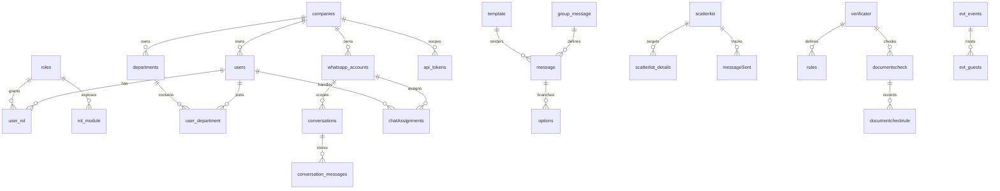

# Backend design and data ownership

All paths in this document are relative to the sibling `WanTrackApi` repository. The complete controller/method index is [09](09-controller-index.md), and the mounted-route catalog is [08](08-api-relationship.md).

## Folder and domain map

| Folder / domain | Responsibility | Frontend relationship |
|---|---|---|
| `src/modules/users/` | Login, profile/user CRUD, roles and membership writes | Login, Admin, Users/UserProfile |
| `src/modules/companies/` | Companies, geographic catalogs, departments and revocable API tokens | Companies/Company and selector inputs |
| `src/modules/conversations/` | Bot groups, messages, options, internal templates, headers/buttons and lookup types | Conversations/Conversation, Templates/Template |
| `src/modules/channels/` | WhatsApp accounts, Meta templates and notifications | WhatsAppAccount, WsTemplates/WsTemplate, navbar |
| `src/modules/scatter/` | Campaign definitions/details, contact selection, sending, copy, lead answers and reports | ScatterLists/ScatterList, LeadsCenter/LeadViewer |
| `src/modules/support/` | Live chat, assignment, stop-AI, normalized conversation store, advisers, transcripts/metrics | Chats/Chat, Advisors/Advisor, Calls, DashboardConversation |
| `src/modules/messaging/` | WhatsApp/Messenger inbound handling, receive records and status polling | Indirect: changes inbox, bot state and reports |
| `src/modules/reports/` | Sent-message records, delivery/read/failure counts, campaign summaries and email pixels | Dashboard, Summary/HistoryTrans |
| `src/modules/integrations/` | Webhook configuration/rules, inbound email hooks and email templates | WebHooks/WebHookMessage, EmailTemplates/EmailTemplate |
| `src/controllers/` | Service-backed CRUD, document OCR/AI, Meta endpoints, dashboard/email test controllers | DocumentsCheck/DocumentCheck; some modules are backend-only or not mounted |
| `src/services/` | SQL for automation, document rules/results, customer data, attachments, external users/missions/colors/summaries; Meta provider orchestration | Service layer used by selected controllers, not a universal backend pattern |
| `src/queries/` | Manager, route composition, compatibility exports, remaining AWS/AI/log/schedule/PoC controllers | Historical import boundary still used by bot/integrations |
| `src/routes/app/` | Main browser-facing REST registration | Current direct contract |
| `src/routes/review/` | Registered external/catalog/operations/report/automation/document/job/webhook routes | Live despite “review” name |
| `src/routes/` standalone routers | Earlier router factories alongside system routes/types | Do not assume factories are mounted |
| `src/events/` | GraphQL schema, repository, sorting, pagination and confirmation conversion | Events/Event screens via the eventsApi GraphQL adapter |
| `src/bot/` | Large bot executor: conversation actions, message sending, variables, integrations and handoff | Operates definitions created by UI; invoked by inbound messaging |
| `src/communication/` | WhatsApp Graph calls/identity, email delivery and Instagram support | Provider effects happen here; some modules have legacy/hardcoded settings |
| `src/clients/`, `src/providers/` | Meta HTTP client and AWS SES sender | Provider boundary |
| `src/server/` | AWS storage, bucket aliases and SQS configuration | Upload/download routes and messaging media |
| `src/queues/`, `src/rabbit/`, `src/workers/` | Email publisher, RabbitMQ lifecycle and separate batch consumer | Backend delivery infrastructure |
| `src/security/` | JWT validation, active-session lookup and API-token lookup | Browser bearer and integration token access |
| `src/interfaces/`, `src/model/`, `src/enum/` | Compile-time shapes and value enums | No shared/generated browser types; not runtime validators |
| `src/conversationutil/` | AI schema/prompt format resources | AI response expectations, not HTTP contracts |
| `src/tools/`, `src/storage/` | AI/speech/utilities, error helper, lexicons and static text | Some tools contain local file side effects; don't execute during discovery |
| `src/poc/` | Strava HTML/image experiments | No identified direct frontend use |
| `src/config/`, `database.ts`, `mongo.ts` | Runtime config and connection setup | Secret-bearing config must stay out of AI examples |
| `migrations/` | Partial SQL migration history for peer identity, API tokens, inbox and events | Not a complete database bootstrap |
| `postman/` | Events/guests request collection | Manual API examples, not evidence of passing tests |
| `.github/`, `.ebextensions/`, `.platform/`, `confignginx/` | Deployment/branch workflows and proxy configuration | API runtime/deployment only |
| `docs/`, `scripts/` | Existing independent documentation work | Preserved by this frontend task |

## Persistence model

MySQL is the active store. `database.ts` creates a `mysql2/promise` pool; `Manager.get` returns either a row array or one row when `isobject=true`. `actionWithParameters` runs parameterized queries, but `action` accepts raw SQL. These methods catch DB errors and return `undefined` or `0`, so callers cannot assume exceptions will propagate. Some controllers also interpolate values into SQL. Transactions are not automatically shared across a controller's multiple Manager calls.

The events repository uses the pool directly and follows its own validation/error conventions. Mongo support is present but not enabled by the observed bootstrap. Interfaces and SQL joins describe more tables than the available migrations create: a new database cannot be reconstructed completely from this repository alone.

This is a **logical relationship diagram inferred from code**, not a claim that all foreign keys exist. The inbox migration explicitly defines unique `(idwhatsapp_accounts, peer_id)`, unique message `wamid`, and cascade deletion from conversations to conversation_messages. Confirm deployed schema before changing data operations.

## Important distinctions

- `group_message → message → options/template`: configured chatbot dialogue definition.
- `lastmessage`, `answer`, `leadsFlow`: bot progression and captured responses.
- `auditTrail`: historical messaging log; `logController` integrates normalized inbox recording.
- `conversations → conversation_messages`: current inbox/thread storage and delivery status.
- `chatAssignments`, `stopIAList`: human ownership and bot suppression. `multiagent`/`multidept` company flags and department memberships influence assignment behavior.
- `scatterlist`, `scatterlist_details`, `messageSent`: campaign definition, recipients and delivery/reporting. The campaign company column is spelled `idcompnay` in this contract.
- `adviser` and `transcription`: adviser analytics, not necessarily the same identity as authenticated `users` assigned to chats.
- `externaluser`, `mission`, `colorprofile`, `conversationsummary`, `comicuser`: separate API capabilities; do not equate `conversationsummary` with normalized inbox rows.

## Security model as implemented

Login checks email/password against SQL, generates a UUID session, stores it in `users.activeSessionId`, and signs a JWT containing user/company/role/session data. A newer login invalidates an older session. JWT generation does not set an expiry in the observed method. Protected middleware checks `visible=1` and the active session ID.

API tokens contain `typ=api`, a token-row ID and company ID. Token records store SHA-256 hashes plus a display prefix and revocation timestamp. Lookup checks the hash, revocation and company match. API token management uses an explicit platform-admin check. API tokens are mapped to company-scoped role 2, but accepted by general bearer middleware; endpoint-level capabilities still need review.

This is not consistent authorization across the application. Several controllers check only supplied IDs; some routes have no authentication at all. Sidebar module filtering is presentation, not a backend permission system. See [06](06-review-findings.md) for concrete security and correctness findings.
