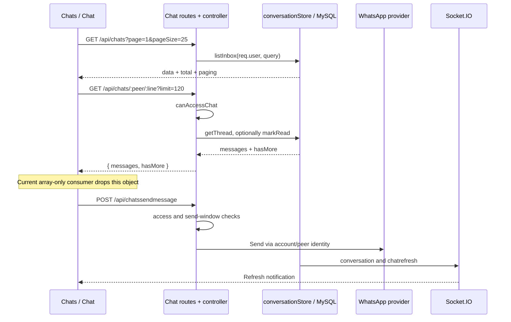

# Integration contracts and end-to-end flows

All API paths are appended to `constants.apiurl`; Socket.IO uses `constants.urlIO`. Examples use placeholders, never real credentials or customer data. [08](08-api-relationship.md) is the exhaustive static request/route map; this document adds manually traced behavior.

## Session contract

1. `Login.js` posts `{ email, password }` to `POST /api/login`.
2. `loginController.post` returns a JSON string containing the JWT, not `{ token: ... }`.
3. The browser stores that string under `constants.token`, fetches `GET /api/users/getByEmail/:email`, Base64-encodes its JSON response under `constants.userinfo`, then navigates to `/admin`.
4. Admin calls `GET /api/validate/:token`, refreshes profile/modules and chooses a landing route.
5. The shared Axios interceptor adds the bearer header to subsequent calls.

Profile responses include `iduser`, `idCompany`, `idroles`, roles and comma-separated module IDs; JWT authorization uses `idrol`. Preserve these casing/name differences until a coordinated migration. A second login invalidates the previous active session; the frontend currently lacks global handling of a later 401. Validation/export URLs place tokens in paths and can leak into logs/history.

## List pagination

Common list query: `?page=1&pageSize=10&search=example`. Many controllers return a bare array without pagination parameters, and `{ data, total, page, pageSize }` when paginated. The frontend hook handles both but treats a fetch failure as an empty list. Chat uses 25 rows per inbox page. Campaign contact detail pagination also has a legacy `pstart` contract; do not substitute the common convention without changing both sides.

GraphQL uses `items`, not `data`, in its page objects. It is a separate interface and cannot be passed directly to `useServerPagination`.

## Live chat

Inbox fields include `phone` (peer identifier), `phoneNumberId`, `name`, line/company labels, preview, unread count, status and assignment metadata. The detail UI stores peer/line/name locally before navigation.

Thread response is **`{ messages: [...], hasMore: boolean }`**. Individual messages expose legacy display aliases such as `idauditTrail`, `message`, `type`, `typeMessage`, `creationdate`, `phoneNumberId`, plus status/actor/wamid/media URL. Incoming direction is 1; outgoing is 0. Backend limits thread pages to 100 despite frontend requesting 120; `before` supports older-history pagination. The current UI does not consume the envelope or page older history.

Text send body: `{ phone, phoneNumberId, message }`. Media upload first posts `FormData` with field `file` to `/api/aws/uploadtemplatemedia/:companyId`, then sends `{ phone, phoneNumberId, url, mimetype, fileName }` to `/api/chatssendmedia`. The UI's 16 MB attachment check is a browser convenience, not proof of a server-side limit. Recording uses MediaRecorder and requires microphone permission/support.

Human attention uses `/api/chatasesorstart` and `/api/chatasesorstop` with peer and line, plus `/api/chatassignment/:phone/:phoneNumberId`. The inbox reads `/api/chatassignments/active` and can close one assignment or close all. Backend access uses company/account ownership and assignment visibility. Preserve bot suppression, assignment state and inbox status together when changing this workflow.

Socket event contracts:

| Event | Backend emission | Current browser consumer |
|---|---|---|
| `chatrefresh` | Marker such as `hi` after chat activity | Chat reload, debounced |
| `notificationrefresh` | Marker after assignment/notification changes | Navbar and Chats refresh |
| `conversation` | Structured payload with conversation summary/peer/line | No subscription identified in this frontend |

Current sockets are not authenticated and structured events are globally broadcast. This is a security finding, not an intended tenancy design.

## Inbound WhatsApp and bot definitions

`GET /api/whastapp/receivemessage` verifies the provider challenge using `verifyToken`. The POST handler acknowledges immediately, optionally forwards/mirrors the webhook, resolves peer and line, and dispatches message/status processing. `botActions.ts` uses configured groups/messages/options/templates, stored progress and training/context to select replies and execute integrations. `communication/whatsapp.ts` performs provider calls; audit/inbox and sent-message records support the UI and reports.

Peer helpers accept phone-like identifiers and business-scoped IDs, using `to` or `recipient` in provider payloads accordingly. Do not strip non-digits from all identities. The GET verification token is not a substitute for validating POST signatures. No POST HMAC verification was found in the reviewed route/middleware path.

## Campaigns and templates

`WsTemplate.js` loads company/account data, validates the template name/components/examples, uploads header media when needed and posts to `/api/wstemplate`. Backend channel controller constructs/submits Meta templates and supports status refresh. Provider calls are real side effects; status correctness needs a controlled provider fixture or test account.

`ScatterList.js` loads campaign, account/template selections and recipient details. It posts campaign fields to the legacy `/api/scatterList` alias, updates recipients/selections, and sends `{ id: campaignId }` to `/api/sendscatterlist`. Backend scatter controller reads template parameters, sends via WhatsApp and records delivery identifiers. Reports join recipients and sent-message status. Excel exports authenticate via a token in the URL.

`Conversation.js` saves a bot group, messages and option links through multiple requests. `Template.js` similarly saves templates plus headers/buttons. These are not one atomic database transaction. Failure halfway can leave a partial configuration. Deleting a bot conversation currently calls a nonexistent `/api/conversation/:id`; do not silently map it to live inbox deletion or a group stored procedure without defining the required semantics.

## Document verification

`DocumentsCheck.js` lists verificators; `DocumentCheck.js` loads a selected verificator, its rules and historical checked documents. It uploads files, posts `{ url, idverificator }` to `/api/documents-check/analize`, then reloads results.

The backend downloads the URL, extracts PDF text or performs Spanish OCR, builds rule prompts, requests AI JSON, calculates a percentage from rule results, inserts `documentscheck`, and inserts `documentcheckrule` rows. Current PDF input and unawaited rule-write defects are in [06](06-review-findings.md). AI output is parsed as JSON without a robust validated result schema in this path.

The editor's Save action posts the loaded verificator-shaped object to `/api/document`, which is an alias for a checked-document insertion handler, then navigates to `/admin/lists`. This does not constitute a working verificator update contract. Also, the upload path's `:companyId` segment receives `document.idverificator`; check storage ownership semantics before modifying this flow.

## Calls, email and events

Calls upload audio to storage or transcript files to the feelings-summary endpoint, then backend AI/transcription logic records analysis for adviser/company dashboards. Feelings is a separate test bench. External AI output, language selection and processing failure need explicit integration tests.

Email templates persist text/HTML and request AI improvement; a preview renders HTML in an unsandboxed srcDoc iframe. Email delivery has both legacy communication code and a RabbitMQ → separate worker → SES path. API startup does not start the email consumer. Preserve delivery/acknowledgement semantics when modifying either path.

`/events/graphql` exposes event types, events, guests, create/update mutations and confirmation status. It uses `evt_event_types`, `evt_events`, `evt_guests`; `Events.js`, `Event.js` and `EventGuests.js` consume it through `services/eventsApi.js`. It is mounted without bearer middleware or resolver authorization in the reviewed source. Do not describe it as protected by the normal REST session layer.

## Manually resolved static-analysis ambiguities

- `useServerPagination` calls `buildUrl`; each list's URL reference supplies the actual endpoint and the hook supplies GET.
- Dashboard's helper selects the six report names listed in its source; all have matching report routes.
- Chat's conditional toggle selects `/api/chatasesorstart` or `/api/chatasesorstop`, both POST.
- HistoryTrans builds `messagesUrl`/`countUrl` from `/api/messagesent` and `/api/messagesentCount` plus filters.
- MetaFlow's local `url` variables address subscribe, phone-numbers and register endpoints.
- Static URL matches do not catch the chat envelope, document-save semantics or authorization failures. These require source-level contract review.

### Events and invitations browser flow (2026-11-07)

Menu module 26 → `/admin/events` → POST `/events/graphql`, query `events(page: {page, pageSize: 10})` → `EventsRepository.listEvents` → `{items,total,page,pageSize}`. Edit links use `/admin/event?id=ID`; create uses `/admin/event`. The editor loads `eventTypes` and, when editing, `event(id)`. `createEvent`/`updateEvent` receive allowlisted EventInput/EventUpdateInput fields. The editor selects existing event types; it does not expose `createEventType`. After successful creation, the returned ID replaces the URL query and enables invitations.

Invitations use `guests(filter: {eventId, search, confirmationStatus}, page)`; search matches **full name only** in the current repository. `createGuest` receives eventId, fullName, integer seats, status, required international phone and optional table/comments/sent date. `updateGuest` omits an unchanged confirmationStatus and always omits confirmedAt so unrelated edits do not reset it. Changed status delegates timestamp handling to the backend (PENDING clears it; other statuses use database NOW). Optional text/date fields can be cleared. The browser requires name and phone on create/edit, validates digits-only international phone numbers using libphonenumber-js/max, and sends the phone string unchanged. The public backend contract still permits nullable phone for other consumers; this change only validates the Eventos form.

GraphQL errors, network failures and missing-event results are surfaced separately from empty lists. GraphQL event and guest operations remain intentionally public. The invitation send workflow below is a separate authenticated REST operation. Existing timeline JSON is not sent by the editor and remains intact on updates. Regression tests use synthetic fixtures only; no live API, database or provider is exercised.

### WhatsApp invitations

The event editor lists company, account and template choices via `GET /api/event-invitation-options`. The editor lists and saves linked templates independently of approval and format. The API checks approval and format when sending. The API recognizes legacy templates linked by phoneNumberId when no account ID is set. Authenticated `GET/PUT /api/events/:eventId/invitation-settings` loads and saves the selected IDs per event and company. Guardar evento writes the event first, then writes any changed complete selection using the resulting ID. If the settings write fails, the editor reports partial success and retains the ID and selection for retry. **Enviar invitaciones** confirms with the saved selection, which the API revalidates on every send. After confirmation the browser processes guests across all pages with an empty sent timestamp, one request at a time to `POST /api/events/:eventId/guests/:guestId/send-invitation`. The API checks an active user session, module 26, company and the template's account, plus the guest/event relationship. It reads `evt_guests.full_name` for each recipient. The approved template has one numbered body variable and one dynamic URL button ending in `{{1}}`. The body takes the guest name and the URL suffix takes standard UTF-8 Base64 of that same guest name.

The API reuses the ScatterList WhatsApp transport and records billing and the send timestamp upon provider acceptance. The database claim prevents resending after acceptance or an uncertain outcome. The UI reports accepted, skipped, rejected and uncertain recipients. Apply the backend migration before deploying this frontend and API together.
